# AI003

同一套效果，三套实现：

- **Unity 6（URP）客户端** — `clients/unity/UnityGameClient`
- **Unreal Engine 5 客户端** — `clients/ue5/UE5GameClient`
- **Go 服务器** — `server`

三端通过同一条 WebSocket JSON 协议通信（见 [protocol/README.md](protocol/README.md)）。

## 定位：技术演示，不是玩法实现

这个仓库是**可复现的跨引擎技术演示**：同一份世界数据、同一套协议与模拟规则，
在 Unity 6 与 UE5 上得到一致的行为，并用脚本、指标和截图证明，而不是靠"看起来像"。

| 技术点 | 证明方式 |
| --- | --- |
| 确定性世界生成 | Go 生成 2048 m 世界，两端加载同一份字节；`world/preview.png` 与双端截图对照 |
| 跨引擎对齐 | 同一出生点、同一移动/重力/相机参数、同一套 CC0 骨骼动画 |
| 实时协议演进 | 协议 v1 → v3 文档 + `cmd/democlient` 可脚本回放 |
| 服务器权威状态同步 | 10 Hz `snapshot` + `/demo` 计数 + HUD |
| 房间帧同步战斗 | 20 Hz 整数毫米模拟、`room.frame`、帧间隔统计 |
| 客户端预测 / 回滚 | 本地领先 3 ticks，HUD 显示 `pred / corr / 误差` |
| 断线重连 | 30 s 状态保留，同 `clientId` 回到原房间 |
| 自动化验证 | `smoke-all`、PlayMode、UE 冒烟、`demo-scenario` + 基线回归、GitHub Actions |

**非目标（当前阶段）**：技能树、任务、经济、匹配大厅等玩法深度；只做到"足以验证技术"。

架构、验证矩阵与演示场景详见 [docs/architecture.md](docs/architecture.md)。

## 30 秒演示（无需引擎）

```powershell
# 1) 起服务器（另开窗口）
.\scripts\build-server.cmd
.\server\bin\ai003-server.exe

# 2) 一条命令跑两个无头客户端 + 打印服务器指标
.\scripts\demo-scenario.cmd -Seconds 8

# 3) 只看实时指标
.\scripts\demo-status.cmd          # 人类可读
.\scripts\demo-status.cmd -Json   # 机器可读

# 4) 指标回归：首次生成基线，之后每次对比
.\scripts\demo-scenario.cmd -Seconds 8 -UpdateBaseline
.\scripts\demo-scenario.cmd -Seconds 8
```

输出包含：两端是否进同一房间、收到的帧数、最大 tick 间隔、命中/死亡事件、
`/demo` 的消息量/字节量/房间帧数。这条链路完全不依赖 Unity 或 UE，可在 CI 里跑
（见 [.github/workflows/verify.yml](.github/workflows/verify.yml)），基线保存在
[demo/baseline.json](demo/baseline.json)。

## 双端同机位对照

```powershell
.\scripts\demo-compare.cmd
```

固定相机（出生点后退 6 m、抬高 3.2 m，看向角色胸口，FOV 62）、同一世界、同一角色、
同一朝向、同样的程序化天空；Unity 用批处理离屏渲染、UE 用 `-AI003DemoShot`，再合成
[docs/images/demo-compare.png](docs/images/demo-compare.png)。

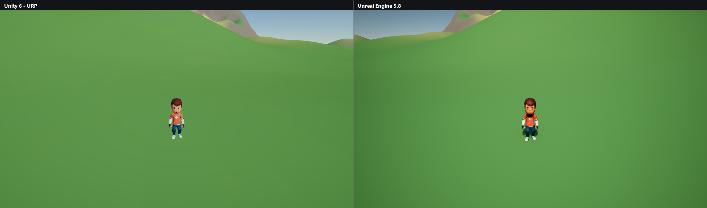

脚本会打印两帧的亮度与像素差异（当前 `Unity 108.6 / UE 105.5`，平均差 `11.3/255`，
89.3% 像素差 ≤24），并输出差分热力图：

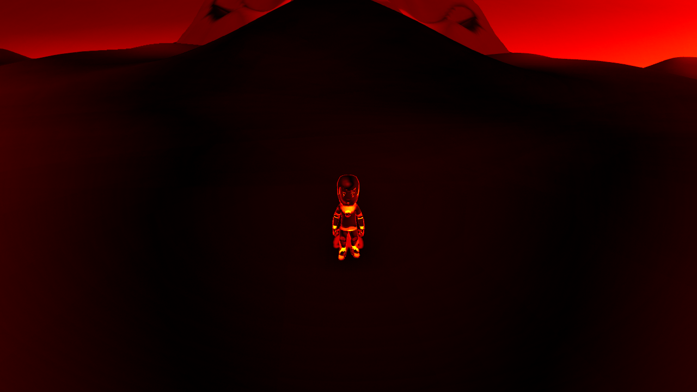

热力图中黑色表示一致、红/黄表示差异大：当前主要差异在天空渐变与角色边缘。
`demo-compare` 支持阈值（`-MaxBrightnessDelta 8 -MinWithin24 80`），
`smoke-all -WithCompare` 会用这组阈值做回归。

## 已实现的技术点

**里程碑 1：开放世界地形 + 角色跑动**（已完成）

- Go 端确定性生成 2048 m × 2048 m 世界：海洋、沙滩、草地、沙漠、岩石、雪顶山峰，
  俯视图见 [world/preview.png](world/preview.png)
- 两端加载**同一份数据**（高度图 / 顶点色 / 生物群系 / 出生点），地形逐顶点一致
- 角色可在世界中跑动：重力、地形碰撞、48° 斜坡、台阶、跳跃、第三人称相机；
  Unity 侧额外支持入水游泳（UE 侧的水面交互待补）
- 角色视觉为 **Kenney Animated Characters: Protagonists**（CC0）骨骼模型 + `Idle` / `Run` / `Jump`
  三段动画，两端加载同一套 FBX 与皮肤贴图，见 [assets/characters/kenney-protagonists](assets/characters/kenney-protagonists/SOURCE.md)
- 支持头less 自动化验证：Unity 数据/网格校验 + PlayMode 物理测试，UE `-game -nullrhi` 冒烟

**里程碑 2：服务器权威状态同步**（已完成基础版）

- 协议 **v2**：`join` / `joined` / `move` / `snapshot`，服务器保存每个玩家的权威位置、朝向、
  速度与状态，按 **10 Hz** 广播快照，见 [protocol/README.md](protocol/README.md)
- 服务器做边界与非法值清洗（位置夹到 ±1024 m、高度 −200..600 m、NaN 归零），
  动画状态（idle/walk/run/jump/swim）也由服务器派生，保证两端表现一致
- Unity / UE 各自 10 Hz 上报本地角色，收到快照后用 `RemoteAvatar`（Unity）与
  `ARemotePlayer`（UE）平滑插值渲染他人；坐标统一为"脚底 + 米 + Unity 轴序"
- 已验证：同时开 Unity Play Mode 与 UE `-game`，两端都能看到对方角色并互相同步位置

| Unity：两个客户端同屏 | UE5：同一场景的远端角色 |
| --- | --- |
| 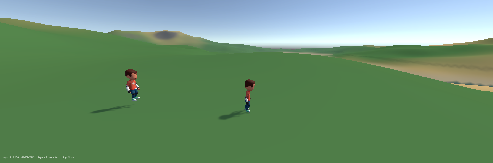 | 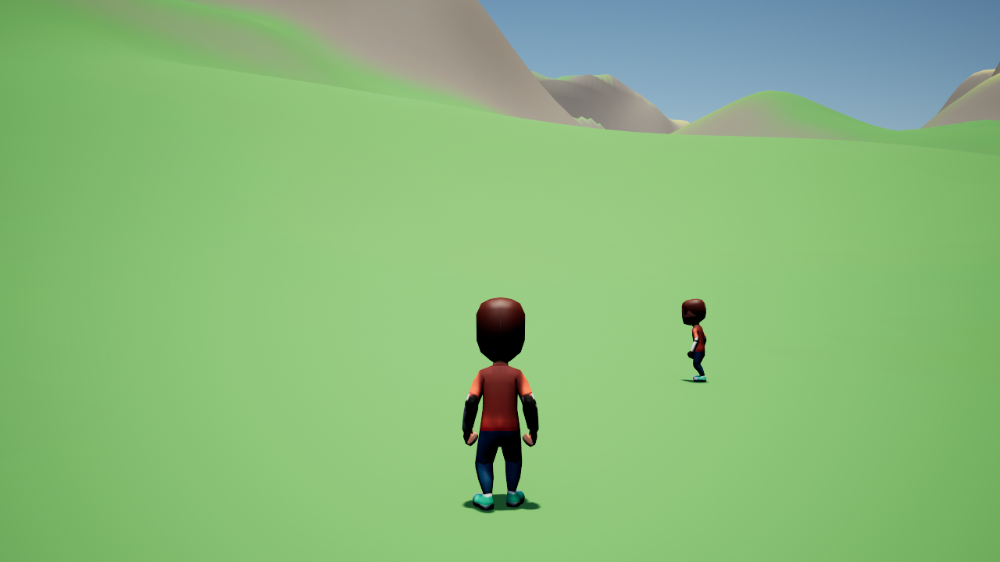 |

**里程碑 3：房间副本 + 帧同步战斗**（基础版已完成）

- 房间由服务器固定 **20 Hz** tick 驱动，位置/速度/战斗全部用**整数毫米**，Go/C#/C++ 结果一致
- 多房间：容量 8，`room.enter` 省略房间号即**自动匹配**（人数最少且有位，满则新建），
  `room.list` 返回房间列表；角色间有 400 mm 半径的整数分离，不会重叠站位
- 客户端预测：本地按同一套整数规则领先服务器 3 ticks 模拟，输入带 tick 号发送；
  服务器帧到达后对比，误差 >50 mm 才回滚到权威位置并重放未确认输入（HUD 显示 corr/误差）
- **战斗表现**：竞技场四周围栏、出拳前冲、受击闪红（UE 用缩放脉冲 + 红色球）、
  伤害数字、死亡倒地变灰、复活恢复；服务器在每次出拳广播 `attack` 事件（落空也有）
- **断线重连**：客户端持久 `clientId`（Unity `PlayerPrefs` / UE `Saved/ClientId.txt`），
  掉线后状态保留 30 s（离线不可被攻击），期内重连回到原房间并恢复血量/位置/槽位
- 输入帧广播 `room.input` → `room.frame`；近战规则：3 m 范围、±60° 锥角、25 伤害、
  1 s 冷却、100 HP、死亡 3 s 后原地满血复活
- Unity 用 `RoomClient`（`AI003_ROOM=1` 开启）、UE 用 `NetSyncSubsystem`（`-AI003Room` 开启），
  两端都按服务器下发的常量与帧进行模拟，HUD 显示血量/帧号/人数
- 实测：Unity 与 UE 机器人同房对战，血量 100 → 75 → …，命中/死亡事件两端一致

| Unity：房间战斗 | UE5：同一房间 |
| --- | --- |
| 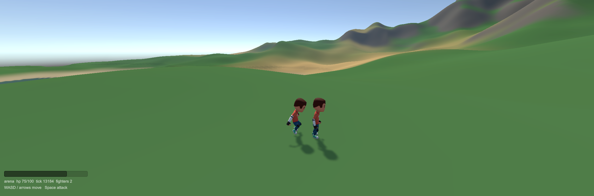 | 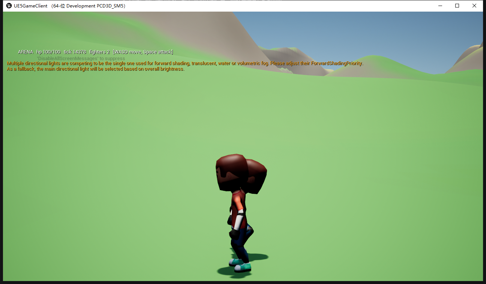 |

| Unity：围栏 + 击打反馈 | UE5：边界线框 + 战斗 |
| --- | --- |
| 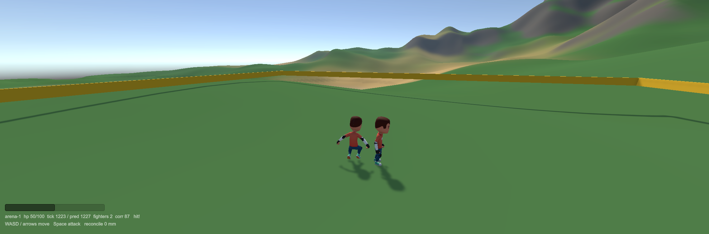 | 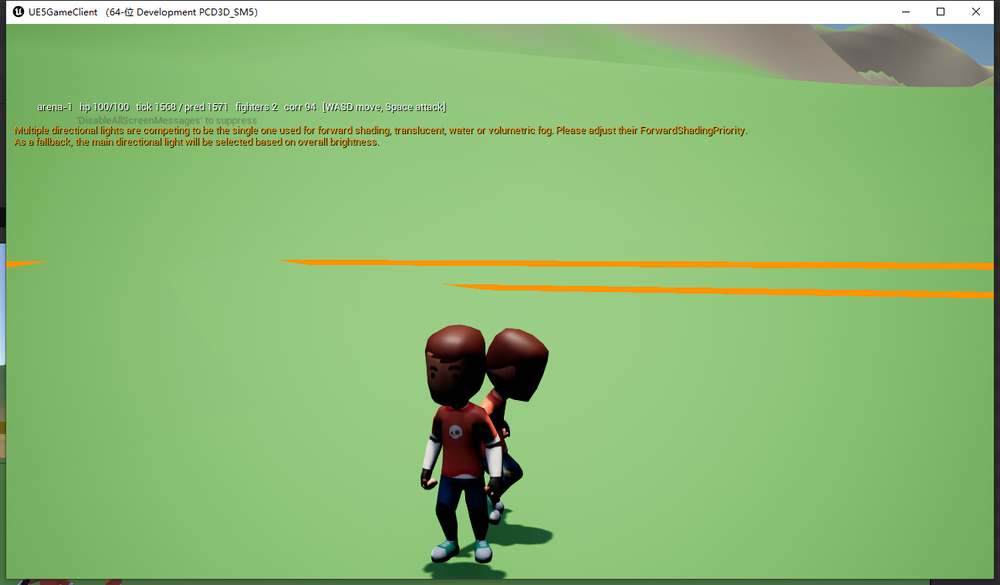 |

| Unity 出生点视角 | UE5 出生点视角 | 世界俯视 |
| --- | --- | --- |
| 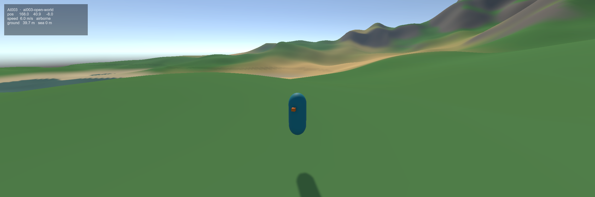 | 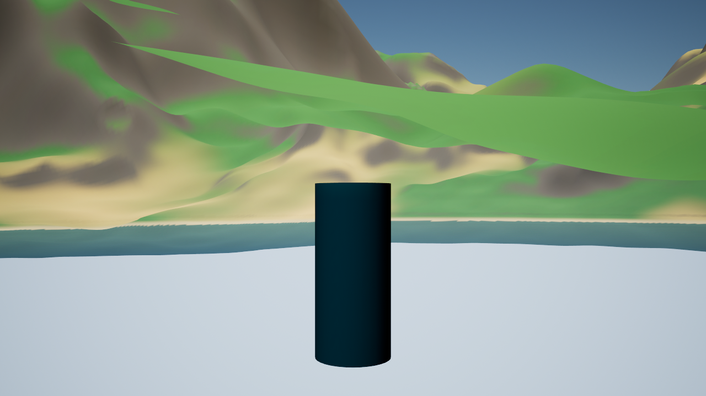 | 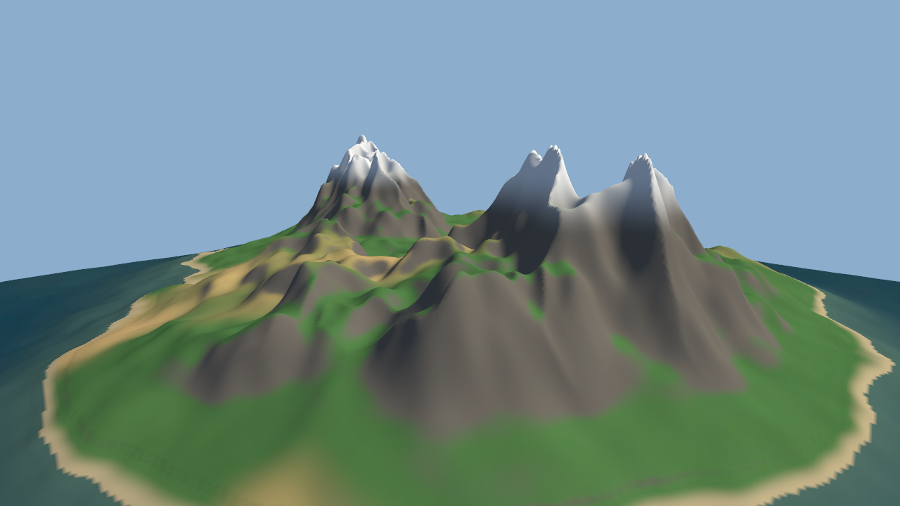 |

| Unity 角色（Idle） | UE5 角色（Idle） |
| --- | --- |
| 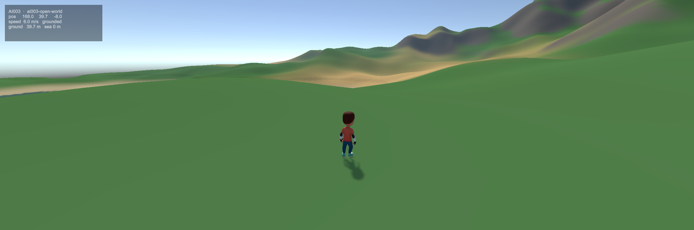 | 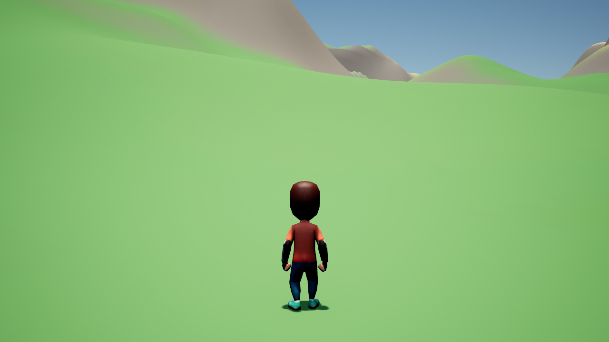 |

> 上图是开发期渲染产物，用 `scripts/smoke-unity.cmd` / `scripts/smoke-ue5-world.cmd` 重新生成。
> 两端光照/材质仍在打磨，见"已知差异"。

此前的环境骨架（WebSocket `ping/pong`）仍然保留并通过测试：

- Unity 批处理模式（编辑器内 C# 联网）→ Go
- Unity **Play Mode**（`ConnectionBootstrap` 自动挂载，等同按下 Play）→ Go
- UE5 C++（`SmokeGameInstance`，头less `-game`）→ Go

## 目录结构

```
ai003/
├─ server/                     Go 模块（module ai003/server）
│  ├─ cmd/server/              网关进程：/healthz + /ws
│  ├─ cmd/pingclient/          命令行冒烟客户端
│  ├─ cmd/worldgen/            世界生成器（导出 world/ 数据）
│  └─ internal/gateway, worldgen   网关与世界生成 + 单元测试
├─ world/                      生成的世界数据（world.json + 二进制数组 + preview.png）
├─ clients/unity/UnityGameClient/   Unity 6 工程（URP 17.6）
│  ├─ Assets/Scripts/Net/      GatewayClient / ConnectionBootstrap
│  ├─ Assets/Scripts/World/    WorldData / WorldTerrain / WorldBootstrap
│  ├─ Assets/Scripts/Player/   ThirdPersonController / OrbitCamera
│  ├─ Assets/Editor/           建场景、世界冒烟、离屏渲染截图
│  └─ Assets/Tests/PlayMode/   联网 + 世界/角色物理测试
├─ clients/ue5/UE5GameClient/  UE 5.8 C++ 工程
│  ├─ Source/UE5GameClient/World/   WorldData / WorldTerrainActor / WorldCharacter / WorldGameMode
│  ├─ Scripts/setup_assets.py       生成 /Game/AI003 材质（Python commandlet）
│  └─ WorldData/                    世界数据副本
├─ protocol/                   三端共享报文定义
├─ scripts/                    PowerShell 构建 / 生成 / 冒烟脚本
└─ docs/environment.md         本机工具链实测记录
```

## 环境要求

| 组件 | 本机版本 | 路径 |
| --- | --- | --- |
| Go | 1.26.3 | `go` 在 PATH |
| Unity | 6000.6.6f1（URP 17.6.0） | `C:\Program Files\Unity 6000.6.6f1` |
| Unreal Engine | 5.8 | `C:\Program Files\Epic Games\UE_5.8` |
| Visual Studio | 2022 17.14 + MSVC 14.44 | C++ 桌面工作负载 |

细节（SDK、许可证、已知限制）见 [docs/environment.md](docs/environment.md)。

## 工程规格

每端有独立的实现规格与忽略规则，改代码前先看对应文档：

| 部分 | 规格 | 忽略文件 |
| --- | --- | --- |
| 仓库级约定 | [docs/specs/README.md](docs/specs/README.md) | [.gitignore](.gitignore) |
| Go 服务器 | [docs/specs/go-server.md](docs/specs/go-server.md) | [server/.gitignore](server/.gitignore) |
| Unity 客户端 | [docs/specs/unity-client.md](docs/specs/unity-client.md) | [UnityGameClient/.gitignore](clients/unity/UnityGameClient/.gitignore) |
| UE5 客户端 | [docs/specs/ue5-client.md](docs/specs/ue5-client.md) | [UE5GameClient/.gitignore](clients/ue5/UE5GameClient/.gitignore) |

## 世界数据与两端一致性

世界不是两端各自用噪声生成的，而是 Go 一次性烘焙成数组，两端只负责渲染：

| 文件 | 内容 |
| --- | --- |
| `world/world.json` | 元数据：seed、尺寸、分辨率、海平面、出生点、文件名 |
| `world/heightmap.f32` | 513×513 的 float32（小端、行优先，单位米），Y 轴向上 |
| `world/colors.rgba8` | 每顶点线性空间 RGBA，两端直接做为顶点色使用 |
| `world/biomes.r8` | 每顶点生物群系 id（海洋/沙滩/草地/沙漠/岩石/雪），用于调试与 HUD |
| `world/preview.png` | 俯视山体阴影图，便于不启动引擎时检查世界 |

- 当前世界：seed `20261103`，2048 m × 2048 m，4 m/格，海平面 0 m，最高峰约 396 m；
  海洋 42%、草地 34%、沙漠 7%、岩石 12%、雪 2%
- 出生点由生成器挑选：海平面以上、坡度 < 15°、半径 30 m 内全是干燥陆地
- 两端都把米换算成自己的单位（Unity 米 / UE 厘米），并直接读取同一份顶点色，
  **不做第二次 sRGB 解码**（UE 用 `CreateMeshSection_LinearColor(..., bSRGBConversion=false)`）

```powershell
.\scripts\generate-world.cmd      # 重新生成，并复制到 Unity StreamingAssets 与 UE WorldData
```

UE 的地形/水面/角色材质由 Python 在编辑器里生成一次（`/Game/AI003`）：

```powershell
.\scripts\setup-ue-assets.cmd
```

## 引擎 MCP

两个编辑器都已接好 MCP，AI 可以直接操作编辑器：

| 引擎 | 服务 | 端口 | DSH server |
| --- | --- | --- | --- |
| Unreal Engine 5.8 | EngineWire 0.6.0（插件 + node 代理） | `3000` | `unreal-engine` |
| Unity 6000.6.6f1 | MCP for Unity 10.3.0（UPM 包 + Python 服务） | `6400` | `unity` |

```powershell
.\scripts\check-mcp.cmd               # 检查两个桥是否在监听
.\scripts\install-enginewire.cmd -Build   # 新机器：装 UE 插件并编译
```

安装细节、DSH 配置片段、token/超时/端口冲突的排查见 [docs/mcp.md](docs/mcp.md)。

## 操作方式

| 操作 | 按键 |
| --- | --- |
| 移动 | `W A S D` |
| 视角 | 鼠标（Esc 释放鼠标，左键重新锁定） |
| 冲刺 | `Shift` |
| 跳跃 | `Space` |

Unity 与 UE 的移动速度、重力、跳跃高度、斜坡限制都在各自角色类里，参数已尽量对齐：

| 参数 | Unity | UE |
| --- | --- | --- |
| 走路 / 冲刺 | 6 / 10 m·s⁻¹ | 600 / 1000 cm·s⁻¹ |
| 跳跃高度 | 1.35 m | 约 1.4 m（JumpZVelocity 520） |
| 重力 | -24 m·s⁻² | 默认 980 cm·s⁻² |
| 可行走坡度 | 48° | 48° |

## 快速开始

### 0. 生成世界数据（首次或改 seed 后）

```powershell
.\scripts\generate-world.cmd
.\scripts\setup-ue-assets.cmd     # 仅 UE 首次需要：生成 /Game/AI003 材质
```

### 1. 启动服务器

```powershell
.\scripts\build-server.cmd
.\server\bin\ai003-server.exe            # 监听 127.0.0.1:8080
```

健康检查与命令行冒烟：

```powershell
Invoke-RestMethod http://127.0.0.1:8080/healthz
cd server; go run ./cmd/pingclient -n 3  # 期望 SMOKE OK
```

### 2. Unity 客户端

用 Unity 6000.6.6f1 打开 `clients/unity/UnityGameClient`，打开
`Assets/Scenes/OpenWorld.unity`（`SetupWorldScene` 已生成并加入 Build Settings），进入 Play Mode。

`WorldBootstrap` 会在场景加载后自动建地形、水、太阳、角色与相机，因此在**任意场景**
按 Play 也能直接进世界。`ConnectionBootstrap` 同时自动挂载并连接网关，Console 里可见：

```
[AI003] world ready: 2048 m, 513x513 vertices, 64 chunks, spawn (168, 40, -8)
[AI003] connected to ws://127.0.0.1:8080/ws
[AI003] pong seq=1 rtt=1ms
```

改地址：环境变量 `AI003_WS_URL`，或场景里改组件字段。

### 3. UE5 客户端

```powershell
.\scripts\smoke-ue5.cmd                 # 编译 Editor 目标 + 头less 冒烟
# 或者只编译：
& 'C:\Program Files\Epic Games\UE_5.8\Engine\Build\BatchFiles\Build.bat' `
    UE5GameClientEditor Win64 Development `
    -Project="$PWD\clients\ue5\UE5GameClient\UE5GameClient.uproject" -WaitMutex
```

然后双击 `UE5GameClient.uproject` 打开编辑器，点 Play 即可进入同一个世界：
`WorldGameMode` 会加载 `WorldData/`、生成 64 块地形与水面、布置太阳/天空/雾，并把角色
放在出生点。只想验证连通性时用 `-AI003Smoke`（`SmokeGameInstance` 的 ping 流程）。

### 4. 一键验证

```powershell
.\scripts\smoke-all.cmd            # Go 测试 + pingclient + Unity + PlayMode + UE5
.\scripts\smoke-all.cmd -SkipUE    # 只验 Unity 侧
```

脚本会自己拉起/关闭临时网关，最后打印汇总表。最近一次实测（2026-11-03）：

```
go-tests   PASS
go-client  PASS
unity      PASS
unity-pm   PASS
ue5        PASS
ue5-world  PASS
```

`unity-pm` 里包含两条 PlayMode 测试：`ConnectionBootstrap` 自动连接、以及世界构建 +
角色落地 + 向前跑动的物理测试。`ue5-world` 是 UE 的 `-AI003WorldSmoke`（头less）。

## 脚本

| 脚本 | 作用 |
| --- | --- |
| `scripts/generate-world.ps1` | 运行 `worldgen` 并分发世界数据到两端 |
| `scripts/setup-ue-assets.ps1` | 用 Python commandlet 生成 `/Game/AI003` 材质（UE 首次） |
| `scripts/build-server.ps1` | `go build` + `go vet` + `go test`，产物 `server/bin/ai003-server.exe` |
| `scripts/smoke-unity.ps1` | Unity 批处理模式跑 `AI003.EditorTools.SmokeTest.Run` |
| `scripts/test-unity-playmode.ps1` | 跑 Unity PlayMode 测试（联网 + 世界/角色物理） |
| `scripts/smoke-ue5.ps1` | UBT 编译 + `UnrealEditor-Cmd -game -nullrhi -AI003Smoke` |
| `scripts/smoke-ue5-world.ps1` | UBT 编译 + `-AI003WorldSmoke`（地形构建 / 落地 / 跑动） |
| `scripts/install-enginewire.ps1` | 下载并启用 EngineWire（UE MCP 插件），可选编译 |
| `scripts/check-mcp.ps1` | 检查 UE 3000 / Unity 6400 两个 MCP 桥 |
| `scripts/mcp-probe.mjs` | 最小 MCP stdio 客户端，用于列出某服务的工具 |
| `scripts/demo-status.ps1` | 读 `/healthz` + `/demo`，打印房间/流量/事件指标（`-Json` 机器可读） |
| `scripts/demo-scenario.ps1` | 两个无头客户端进同一房间对战 + 指标基线校验（不需要引擎） |
| `scripts/demo-compare.ps1` | 固定机位截取 Unity / UE 两帧、合成对比图与差分热力图，可设阈值 |
| `scripts/smoke-all.ps1` | 上述全部串起来，带超时与汇总 |

每个 `.ps1` 旁边都有同名 `.cmd`，双击或 `cmd /c` 调用即可（本机 PowerShell 执行策略为
Restricted，`.cmd` 会自动带 `-ExecutionPolicy Bypass`）。

日志与测试结果统一写到 `artifacts/`（已被 git 忽略）。

## 端口

| 用途 | 地址 |
| --- | --- |
| HTTP 健康检查 | `http://127.0.0.1:8080/healthz` |
| 演示指标（JSON） | `http://127.0.0.1:8080/demo` |
| WebSocket 网关 | `ws://127.0.0.1:8080/ws` |

改端口：`.\server\bin\ai003-server.exe -addr 0.0.0.0:9000`，客户端用 `AI003_WS_URL` 跟随。

## 已知差异 / 待补

| 项 | 现状 | 计划 |
| --- | --- | --- |
| 离线冻结 | 离线玩家不可攻击、复活计时暂停，重连后继续 | 离线期间仍推进复活/冷却，或直接判负 |
| 世界同步身份 | 大世界的 `join` 仍以会话 id 记玩家，重连会新建 | 世界玩家也改用 `clientId` 持久身份 |
| 双端画面统一 | 机位/角色/天空/曝光已对齐；平均像素差 11.5/255，色调仍有细微差 | 统一色彩分级/LUT，做差分热力图 || 指标回归 | `/demo` 与 `demo-scenario` 可手工跑 | 纳入 `smoke-all`/CI，保存基线并比较 |
| 预测范围 | 只预测位置/朝向；血量、冷却、命中仍等服务器帧 | 命中/受击也做预测 + 视觉反馈 |
| 预测与分离 | 预测不含角色间分离，贴身推挤时校正次数偏高 | 在预测步进里加入确定性的角色分离 |
| 竞技场表现 | 有围栏、前冲、伤害数字、倒地，但围栏无碰撞、非正式场景 | 独立竞技场场景与正式特效 |
| UE 战斗表现 | 围栏/受击反馈用 `DrawDebugBox`/`DrawDebugSphere`/`DrawDebugString` | 换成正式模型/材质/ Niagara 特效 |
| 远端动画 | 用服务器派生的 anim 名称做单节点切换，无混合、无位移匹配 | 状态机/混合树、脚步同步 |
| UE 光照观感 | 色调偏灰、角色背光面偏暗，天空/雾还在调 | 对齐 Unity 的曝光与补光，必要时加后处理体积 |
| 水下物理 | Unity 有游泳浮力，UE 仍是"水下行走" | UE 补 `MOVE_Swimming` 或自定义浮力 |
| 地形精度 | 4 m 网格、平滑着色，近看缺少细节 | 加贴图/法线细节或提高分辨率 + LOD |
| 世界加载 | 一次性建 64 块，2 km 内全量 | 流式加载 / 分块 LOD，支撑更大世界 |

## 接下来（按技术演示排序）

1. **双端同机位对照**：固定相机、统一光照/后处理，一键生成 Unity vs UE 对比图；
2. **指标回归**：把 `/demo` 与 `demo-scenario` 纳入 `smoke-all`/CI，记录帧数、tick 间隔、
   消息量、事件数基线，回归时对比；
3. **场景化演示脚本**：地形、同步、预测、重连、战斗各一段可复现操作与截图/GIF；
4. **世界规模演示**：流式加载/分块 LOD，展示大于 2 km 的世界；
5. **表现层替换**（可选）：正式竞技场与特效，提升截图观感。
