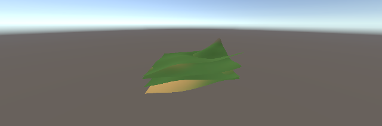

# Entities Graphics 地形复测报告（Phase 2.1）

## 结论

**SubScene 烘焙路径可用**：在交互式编辑器里打开/关闭 `TerrainSubScene` 后，内容场景经
`SubSceneImporter` 烘焙，Play 模式下 4 个地形 chunk 由 Entities Graphics 正常渲染。

运行时批量创建实体的路径仍不稳定，见文末。

## SubScene 烘焙（可用）

复现步骤：

1. 打开 `Assets/World/Baked/BakedWorld.unity`
2. 选中 `TerrainSubScene`，点击 **Open**（打开内容场景），再点击 **Close**
   （等价菜单：`AI003 → Bake Terrain SubScene`）
3. 关闭后 `Assets/SceneDependencyCache/*.sceneWithBuildSettings` 会被
   `SubSceneImporter` 导入（Editor.log 可见），生成烘焙实体数据
4. 进入 Play：`MaterialMeshInfo` 实体 = 4（2×2 chunk），关闭 `[AI003] Terrain`
   的 GameObject 渲染后，地形仍由 Entities Graphics 显示

烘焙脚本：`Assets/Editor/BakeTerrainSubScene.cs`
- 生成内容场景（4 个 chunk + 网格/材质资产）和 `BakedWorld.unity`（SubScene 引用）
- 写入 `_SceneGUID`（批处理下 `OnValidate` 不生效）
- 通过内部 API `AssetDatabase.SetImporterOverrideInternal` 选择 `SubSceneImporter`

已知限制：
- **批处理**（`-batchmode -executeMethod`）不会触发烘焙产物；需要在交互式编辑器里
  完成一次 Open/Close（或菜单）
- **规模**：目前只验证了 2×2（4 chunk）。扩到 16/64 chunk 时烘焙实体渲染出错
  （块错位/黑色撕裂），2×2 正常，判断与自定义地形 shader 在多实例下的
  DOTS instancing 读取有关；需要改成真正 DOTS 兼容的 shader（或 URP Lit + 顶点色方案）
- 烘焙产物在 `Assets/SceneDependencyCache`，属于本机生成缓存（已 gitignore）

## 运行时批量实体（仍不稳定）

- URP Lit + 运行时实体：✅ 可渲染
- 自定义地形 shader + **手动创建**实体：✅ 可渲染（1 / 16 / **256** 个）
  - 证据：[256 个手动实体](images/ecs-terrain-manual-256.png)
- `TerrainStreaming` 启动帧批量创建：❌ 不绘制
  - 证据：[灰色地面](images/ecs-terrain-runtime-entities.png)
- 组件、包围盒、材质、网格、创建时机均已对比，差异未定位；默认仍走 GameObject 渲染，
  运行时 ECS 路径保留为 `AI003_TERRAIN_ECS=1` 实验开关

## 结论与后续

- 地形迁移 Entities Graphics 的可行路径是 **SubScene 烘焙**；适合静态世界，不适合
  运行时流式加载（流式需要运行时实体或 BRG 直绘）
- 若要做流式 ECS 地形，下一步应评估 `BatchRendererGroup` 直绘
