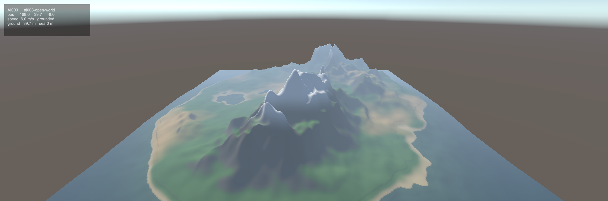

# Entities Graphics 地形复测报告（Phase 2.1）

## 结论

**整张 2 km 世界已通过 SubScene 烘焙 + Entities Graphics 渲染。**

关键改动：地形材质从自定义顶点色 shader 换成 **URP Lit + 世界顶点色贴图**。
URP Lit 的 DOTS instancing 是官方支持的，256 个 chunk 一起渲染不再出现错位/撕裂；
每顶点颜色烘焙成 513×513 的 `TerrainColor.asset`，chunk 的 UV 本来就是归一化世界坐标，
所以一张纹理覆盖整张地图。

## 复现

1. 打开 `Assets/World/Baked/BakedWorld.unity`，选中 `TerrainSubScene`
   → Inspector **Open** → **Close**（或菜单 `AI003 → Bake Terrain SubScene`）
2. 关闭后 `Assets/SceneDependencyCache/*.sceneWithBuildSettings` 经 `SubSceneImporter` 导入
3. Play：`MaterialMeshInfo` 实体 = **256**；关闭 `[AI003] Terrain` 的 GameObject
   渲染后，整张地形仍由 Entities Graphics 显示

烘焙脚本 `Assets/Editor/BakeTerrainSubScene.cs`：
- 生成 16×16 chunk 内容场景、256 个网格资产、世界颜色贴图与 URP Lit 材质
- 写入 `_SceneGUID`、通过内部 `AssetDatabase.SetImporterOverrideInternal` 选择 `SubSceneImporter`
- 自动 Open/Close 并清理 `SceneDependencyCache` 强制重烘焙

## 限制

- **批处理**（`-batchmode -executeMethod`）不会触发烘焙产物；必须在交互式编辑器完成一次 Open/Close
- 烘焙产物在 `Assets/SceneDependencyCache`（本机生成缓存，已 gitignore）
- 运行时**流式**地形仍走 GameObject 路径；ECS 流式（BRG 直绘或分块 SubScene）是后续工作
- 骨骼角色仍需 DOTS skinning