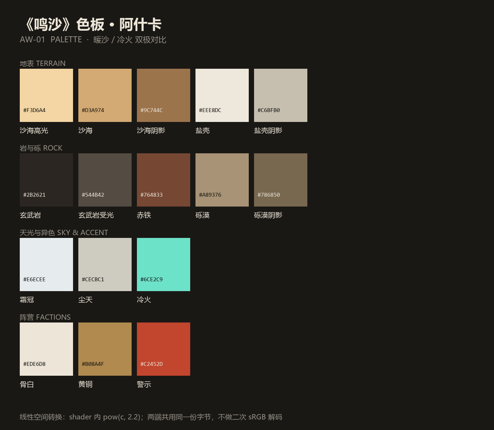
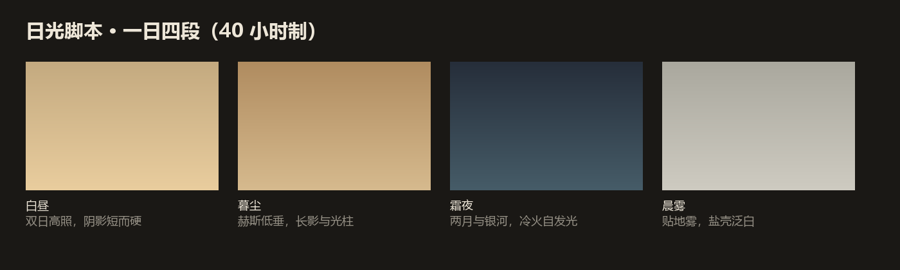

# 03 · 美术方向

> 一句话命题：**在过曝的白与极深的黑之间，一片暖沙、一层低饱和的绿、一道蓝灰的雪坡；人是画面里最小的东西。**
>
> 六种地形各自成立：沙、盐海、温带林、大草原、雪原、高山岩壁。同一套双日光照，各有自己的主色、植被密度与雾。
>
> 五张关键帧概念参考见 [06-concept-frames.md](06-concept-frames.md)。

## 1. 我们参考电影版《沙丘》的什么

只参考**语言**，不参考**表达**。逐条对应到可执行的制作规则：

| 参考的语言 | 具体到我们 |
| --- | --- |
| **巨物尺度**：人永远很小，结构/生物永远很大 | 每张关键截图必须有一个"人形参照物"；井塔 80–150 m、长者 180–400 m |
| **单色场景**：一场戏基本只有一个色系 | 白昼沙地=沙色系；温带林=低饱和绿+落叶褐；大草原=干草金+橄榄绿；雪原=白+蓝灰；高山=岩灰+雪白；霜夜=蓝黑系；曜庭内部=骨白+黑。**禁止**在同一画面里出现三个以上色系 |
| **硬光深影**：沙漠正午的直射光，阴影几乎是黑的 | 主光 5600 K、仰角 15–45°；阴影区不补平，只靠天空环境光提一点 |
| **大气透视**：远景一层一层化进天空 | 至少两级雾（贴地 0–40 m + 远景 300–2200 m）；远景饱和度逐层下降 |
| **低饱和 + 少量高饱和**：整体去色，只在关键物上给饱和 | 沙与岩压到 20–35% 饱和；**冷火**是唯一允许的高饱和青 |
| **材质真实**：混凝土的模板痕、织物的褶皱、金属的磨损 | 每个材质必须有"缺陷层"（污渍/裂纹/补丁），不用纯色 |
| **克制的特效**：沙尘、光晕，不做粒子烟花 | 全屏特效只允许：雾、尘、热浪、Bloom、颗粒 |
| **安静的声音**：低频、空旷、长混响 | 风的三层叠加 + 30 Hz 低频底噪；不用打击乐 |

## 2. 我们**不**参考什么（法律与识别度双重原因）

| 不复制 | 原因 |
| --- | --- |
| 具体造型：扑翼机、蒸馏服管路、沙虫圆口利齿、家族纹章、电影标题字体 | 这些是受保护的"表达"，且一眼可辨 |
| 具体镜头：逐帧翻拍电影构图 | 摄影作品受著作权保护 |
| 电影剧照作为 mood board 存档/分发 | 复制与传播风险；改用文字描述 + 自绘 |
| 汉斯·季默的配乐与音效设计 | 音乐著作权；且声音辨识度极高 |
| 从电影画面直接提取的 LUT | 属于对他人影像的演绎复制；我们用"色温/对比"文字规格自己调 |

详见 [05-legal.md](05-legal.md)。**内部讨论可以说"参考《沙丘》的摄影语言"，对外宣发不提。**

## 3. 色板

完整色板见 `docs/images/worldview/palette.png`。核心 12 色：

| 用途 | 名称 | Hex | 占比 |
| --- | --- | --- | --- |
| 沙海高光 | Sand lit | `#F3D6A4` | 15% |
| 沙海 | Sand | `#D3A974` | 25% |
| 沙海阴影 | Sand shadow | `#9C744C` | 20% |
| 盐壳 | Salt | `#EEE8DC` | 10% |
| 盐壳阴影 | Salt shadow | `#C6BFB0` | 5% |
| 砾漠 | Reg | `#A89376` | 10% |
| 玄武岩 | Basalt | `#2B2621` | 8% |
| 玄武岩受光 | Basalt lit | `#544B42` | 3% |
| 赤铁 | Rust | `#764833` | 2% |
| 霜冠 | Frost | `#E6ECEE` | 1% |
| 尘天 | Dust sky | `#CECBC1` | 环境色 |
| **冷火** | **Coldfire** | **`#6CE2C9`** | **1%（唯一高饱和）** |

阵营色：

| | 主 | 副 | 点缀 |
| --- | --- | --- | --- |
| 曜庭 | 骨白 `#EDE6D8` | 黄铜 `#B08A4F` | 玄武岩黑 `#2B2621` |
| 盐路盟 | 赤褐 `#8C4A32` | 炭黑 `#23211F` | 褪色青 `#5E7A72` |
| 井民 | 盐白 `#EFE9DC` | 绳褐 `#6B5A45` | 钟铜 `#8A7A55` |
| UI 警示 | — | — | `#C2452D` |

**规则**：暖色（沙/赤铁/黄铜）占 60–75% 只约束 **沙漠/盐海** biome；每个 biome 的主色占比见 3.1。
冷色仍然只允许来自**阴影、天空、冷火**这三处，不分 biome。**冷火是唯一的高饱和色**；森林的绿、草原的金都不许超过 40% 饱和度。

### 3.1 Biome 色板

世界文件里的顶点色是**线性**值（`colors.rgba8`），主题层重采样后按 biome 再压一次饱和度。
离散 `biomes.r8` 只做粗决策，且按 ≥8 m 降采样——1 m 尺度有斑点噪声，直接上色会出椒盐。

| Biome | 名称 | Hex | 占比 |
| --- | --- | --- | --- |
| 温带林 | 林冠受光 / 林冠 / 林冠阴影 | `#8AA06B` / `#5F7A4C` / `#33452F` | 绿 55–65% |
| 温带林 | 落叶层 / 树皮 / 苔藓 | `#7C6344` / `#4A3B2E` / `#6B7A45` | 褐 20–30% |
| 大草原 | 草花受光 / 草 / 草阴影 | `#BEB083` / `#9A8F68` / `#5F5940` | 金 55–65% |
| 大草原 | 土黄 / 稀疏褐 | `#A89376` / `#6B5A45` | 土 15–25%、褐 10–15% |
| 雪原 | 雪受光 / 雪 / 雪阴影 | `#F5F8FA` / `#DDE7ED` / `#A7BCD1` | 白+蓝灰 70–80% |
| 雪原 | 冰 / 裸岩 | `#9DB4C6` / `#5A5750` | 裸岩 10–20% |
| 高山 | 岩壁受光 / 岩壁 / 岩壁阴影 | `#8C8273` / `#6A6156` / `#3B362E` | 岩灰 60–70% |
| 高山 | 高处积雪 | `#E9EFF3` | 雪 20–30% |

三条硬规则：

- **森林的绿饱和度 ≤ 40%**，暖色只允许出现在落叶层与主光方向；
- **草原主色饱和度 S ≤ 0.33**（草 `#9A8F68` 实测 0.325），比森林（地面 0.353 / 林冠 0.377）低一档；绿色只作为零星植被点缀，不许出现成片饱和绿；
- 雪地只允许主光方向 ≤10% 的暖色。

## 4. 光

### 4.1 双日

| 光源 | 色温 | 强度 | 角度 | 作用 |
| --- | --- | --- | --- | --- |
| 赫斯（主） | 5600 K | 1.0 | 仰角 15–45°，随光段移动 | 主光、硬阴影 |
| 维尔（伴） | 2800 K | 0.22 | 固定在对侧，仰角 25° | 第二道影、暖色轮廓光 |
| 天空 | 尘天 `#CECBC1` | 环境光 | — | 唯一允许"提亮阴影"的光源 |

- **双影**：主光阴影锐利（软阴影半径小），伴光阴影更虚更淡。两者夹角 100–140° 最出效果。
- 阴影色**偏冷**（向 `#4A5A66` 靠），不要用纯黑。

### 4.2 体积光与尘

URP 17.6 **没有内置体积雾**。方案：

| 效果 | 实现 |
| --- | --- |
| 贴地尘雾 | 全屏 Pass（`FullScreenPassRendererFeature`）用深度重建世界坐标，做高度雾 + 朝阳方向的散射 |
| 光柱 | 低角度主光 + 尘雾 + 少量镜头光晕；必要时用锥体网格加软边 |
| 热浪 | 屏幕空间 UV 扭曲，幅度随距离与地面高度变化 |
| 沙暴墙 | 半透明层叠网格 + 噪声 + 全屏色偏，不做体积模拟 |

### 4.3 夜

- 双月是唯一硬光源，色温 9000 K，强度 0.15。
- 冷火自发光是画面里唯一的高光点，Bloom 阈值要压到刚好只吃它。
- 星空用程序化 cubemap 或 shader，不用贴图。

### 4.4 森林、草原、雪地、高山

| Biome | 光 | 雾 |
| --- | --- | --- |
| 温带林 | 双日不变，主光经树冠过滤成光斑（方向光 cookie + 树冠遮挡）；环境光偏冷绿 `#6E7C63`（地面反照率低） | 低层水汽 20–120 m，远景 300–1800 m；**不做尘** |
| 大草原 | 主光仰角 15–35°，几乎无遮挡；天空光占主导，阴影短而软 | 远景 400–2400 m，贴地雾 <10 m（可留热霾）；不用树冠 cookie |
| 雪原 | 雪面反照率 0.75–0.85，环境反弹必须算进去；阴影强制偏蓝 `#8FA6C0`；主光强度 −0.3 防死白 | 远景雾更亮、接近天空色，两级雾保留 |
| 高山 | 主光仰角 10–25° 拉长岩壁明暗，靠山体自阴影；雪帽与岩壁必须落在同一帧 | 高度雾分层，云带 250–350 m |

## 5. 材质

| 材质 | 粗糙度 | 法线/细节 | 特殊 |
| --- | --- | --- | --- |
| 沙 | 0.85–0.95 | 沙纹（各向异性条纹，方向随风） | 边缘包裹光照（wrap diffuse）模拟次表面 |
| 盐壳 | 0.25–0.55 斑驳 | 龟裂掩码 | 强镜面 + 斑点高光 |
| 玄武岩 | 0.75 | 柱状节理（六边形近似） | 三平面映射，避免拉伸 |
| 混凝土 | 0.8 | 模板痕、气孔 | 边缘积尘（世界向上蒙版） |
| 骨瓷/陶瓷 | 0.35 | 极少 | 轻微次表面 |
| 黄铜 | 0.3 | 磨损 | 金属，反射环境 |
| 帆布 | 0.9 | 织纹、褶皱 | 双面、风摆 |
| 晶体（冷火） | 0.05 | 面状切面 | 折射 + 夜间自发光 |
| 针叶/树叶 | 0.7 | 双层法线（叶簇 + 枝干） | 双面、风摆、透光次表面 |
| 树皮 | 0.85 | 竖向裂纹 | 苔藓按高度与世界向上蒙版 |
| 落叶层 | 0.9 | 碎叶散布 | 踩踏压痕可选 |
| 草 | 0.9 | 风浪方向（与主光同侧） | 顶点风摆，密度渐变到裸土 |
| 雪面 | 0.6–0.8 | 风蚀波纹 + 雪粒闪点 | 次表面散射 + 蓝移阴影 |
| 高山岩壁 | 0.7–0.85 | 层理 + 崩落面 | 三平面映射，避免拉伸 |

**统一规则**：所有材质都要有"脏"的一层，按 biome 取 —— 沙/盐海是沙尘在向上的面沉积（`saturate(worldNormal.y)` 蒙版），
森林是落叶与泥点，草原是枯草与裸土斑块，雪地是风蚀薄雪。同一蒙版通道，换的是覆盖色。
这一条比任何高模都更能让画面"像真的"。

### 5.1 森林与大草原的区分（可执行口径）

两者用的是**同一份 grass 数据**（`colors.rgba8` 的连续色，不新签 biome），区别全部由 Unity 侧承担。
判别量是**反解湿度 `m`**：worldgen 画纯草顶点时 `color = shade * mix(colGrassD, colGrass, clamp01(moisture*1.15))`，
给定顶点色可解出 `shade` 与 `m`（加权最小二乘，残差 <2%、shade 0.85–1.15、m −0.02–1.02 才收）。
**它只能按块用**：单顶点噪声 8.3%，只有 21.7% 的顶点能读；32 m 块均值噪声 ≈0.5%，块间真信号 sd=0.086（约 17 倍）。
完整判定函数见 [`artifacts/world-audit-l1a.md`](../../artifacts/world-audit-l1a.md) 第 2 节。

| 判据 | 温带林 | 大草原 |
| --- | --- | --- |
| 反解湿度（32 m 块均值） | `m_block ≥ 0.72` | `m_block ≤ 0.62` |
| 块内平均坡度 | ≤ 0.55（29°） | ≤ 0.35（19°） |
| 林冠覆盖率（8 m 网格树冠投影） | ≥ 60% | ≤ 5% |
| 树密度 | ≥ 0.35 株/100 m²（间距 ≤ 17 m） | ≤ 0.02 株/100 m²（只留孤树） |
| 地表材质 | 落叶层 + 苔藓，绿主导 | 干草 + 裸土斑块，金主导 |
| 天空占比（同机位） | ≤ 25% | ≥ 45% |

判定顺序（全部在作者工具里预算，Play 时不重算）：

1. 32 m 块（或 8 m 网格再 4×4 聚合）取块内草权重与 `m` 的均值；1 m 离散 `biomes.r8` 只做粗筛，不进判定。
2. `m_block ≥ 0.72` 且坡度 ≤0.55 且 48 m 邻域同样达标 → 森林候选；`m_block ≤ 0.62` 且坡度 ≤0.35 → 草原。
3. `0.62 < m_block < 0.72` 是过渡带，24 m 内密度线性插值，避免林缘一刀切。
4. 坡度 >0.70（35°）一律不种树，其余草区按草原处理。

实测可用地块：森林最大连续 **80,896 m²**（832×352 m @ (−144, 720)），大草原最大 **29,696 m²**（288×384 m @ (336, 176)）。

## 6. 构图与镜头

| 规则 | 说明 |
| --- | --- |
| 画幅 | **2.39:1** 遮幅（游戏内 letterbox，UI 不进遮幅） |
| 机位 | 主导低机位（膝盖/腰部高度），仰拍；避免俯视全景当主画面 |
| 焦段 | 尺度用 24–35 mm；压缩沙丘层次用 85–135 mm |
| 主体占比 | 关键截图里主体不超过画面 15%，留 40% 以上负空间 |
| 地平线 | 放在上 1/3 或下 1/3，**不要放中间** |
| 运动 | 缓慢横移/推进（< 1 m/s 等效），避免甩镜 |
| 前景 | 每张画面至少一层前景（沙脊、绳、布料边缘）压住角落 |
| 对称 | 建筑场景用严格中心对称；自然场景用偏心构图 |

## 7. 后期管线

顺序（URP Volume）：

1. **Tonemapping**: ACES
2. **Color Adjustments**: 对比 +12，饱和 −18，色温 +6
3. **Split Toning / Shadows Midtones Highlights**: 高光偏暖 `#FFD9A8`，阴影偏青 `#5C7C8A`
4. **Bloom**: 阈值 1.10，强度 0.35（只吃冷火与太阳）
5. **Vignette**: 0.28
6. **Film Grain**: 0.03，响应式
7. **Chromatic Aberration**: 0.12（极轻）
8. **Letterbox**: 2.39:1，纯黑
9. **逐机位曝光**：雪地 −0.35…−0.15、森林 +0.05…+0.1、草原 −0.1…0（`AshkarStill` 的 `Look.exposure`），
   只覆写机位，不改全局 profile。

**禁止**：色差开大、扫描线、故障风、镜头脏污贴图叠太厚 —— 这些会立刻把画面拉回"游戏滤镜"。

## 8. UI / HUD

- 细线（1 px）、无填充、骨白 `#EDE6D8`、半透明底 `rgba(20,18,16,0.55)`。
- 数字用等宽字体（现有 Consolas 可用），中文用思源黑体/微软雅黑。
- 布局贴边，不遮挡中心。
- 沙漏刻度作为进度/计时的统一图形语言。
- HUD 只保留：位置、帧率/延迟、玩家数、当前光段、大潮倒计时。

现有 HUD（左上角位置块、左下角 id/players/ping）可以直接沿用布局，只换字体、颜色与图形语言。

## 9. 声音

| 层 | 内容 |
| --- | --- |
| 风 | 3 层：低频宽带（40–120 Hz）、中频呼啸、高频沙粒摩擦，随高度与光段变化 |
| 沙鸣 | 沙丘共振：带通噪声 + 共振峰，在长者接近时出现 |
| 机械 | 帆撬的绳索、滑板摩擦、帆布拍打 |
| 空间 | 井塔内部的长混响（8 s），室外几乎无混响 |
| 音乐 | 不做持续配乐；只在进入演示时一段 20 s 的低频氛围 |

全部程序化或自制，不采样电影。

## 10. 截图评审清单

每张对外使用的截图，逐条打勾：

- [ ] 画面里有**人形或器物**作为尺度参照？
- [ ] 能看出**两个方向**的阴影？
- [ ] 远景至少有**两层**雾/大气透视？
- [ ] 高光**过曝但没死白**（保留一点点细节）？
- [ ] 有一处**冷色**（阴影蓝 / 冷火）打破暖调？
- [ ] 负空间 ≥ 40%？
- [ ] 沙漠/盐海没有绿色（第一井灌溉斑块除外）？
- [ ] 森林只有一种低饱和绿系、草原没有成片饱和绿？
- [ ] 同机位下森林与大草原能一眼分开（林冠遮挡 vs 开阔天空）？
- [ ] 没有出现三个以上色系？
- [ ] 2.39:1 遮幅内构图完整？

## 11. 反例：什么会让它变成"普通沙漠游戏"

| 反例 | 为什么不行 |
| --- | --- |
| 饱和的蓝天 + 白云 | 立刻变成"度假村"，失去压迫感 |
| 正午顶光、均匀照明 | 没有阴影就没有尺度与戏剧性 |
| 高饱和荧光绿 / 热带棕榈 | 温带林允许低饱和绿，荧光绿与棕榈会立刻变成"度假村" |
| 全白无阴影的雪地 | 没有蓝灰阴影与层次，就是一张过曝白纸 |
| 草原上密集成片的树 | 那就成了森林；草原靠开阔天空、孤树与风摆草地成立 |
| 紫粉色晚霞 | 太常见的"游戏感"配色 |
| 满屏粒子与光效 | 与"克制"相反 |
| 描边/卡通渲染 | 与"材质真实"相反 |
| 道具堆砌 | 巨物尺度靠"空"来衬托，不靠"满" |
