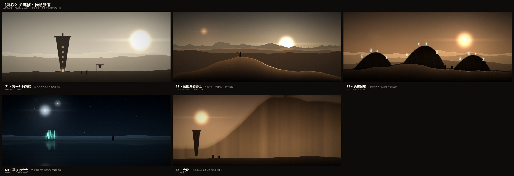
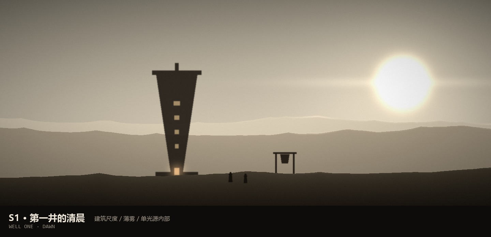
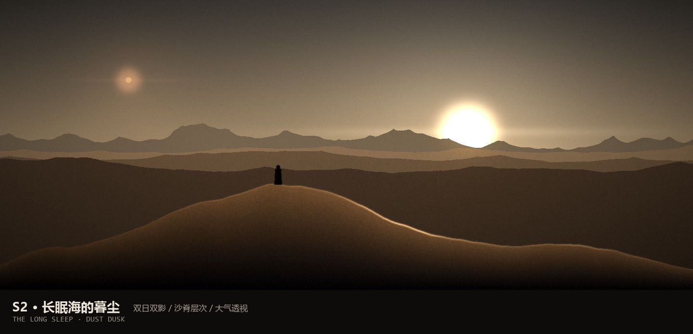
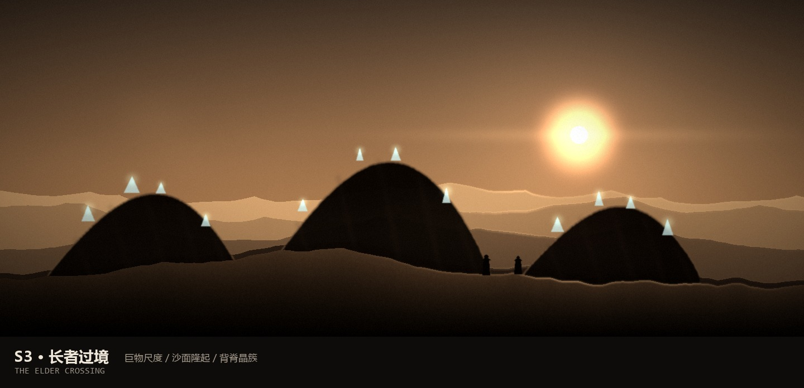
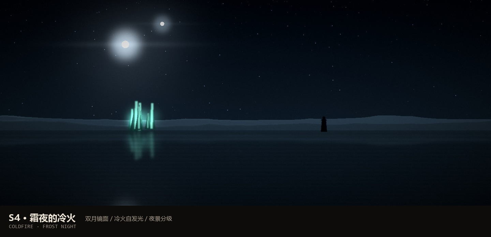
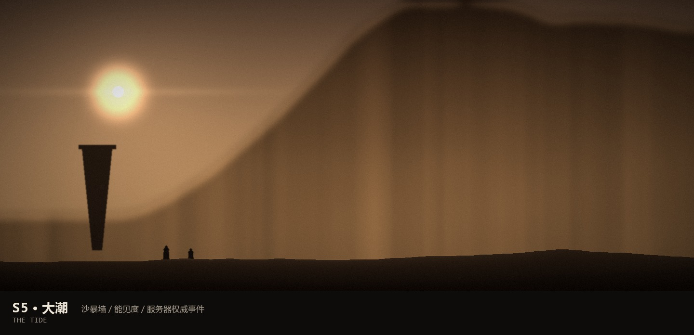
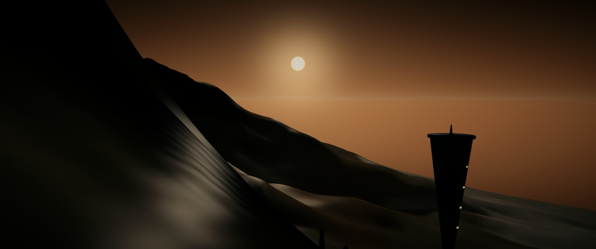
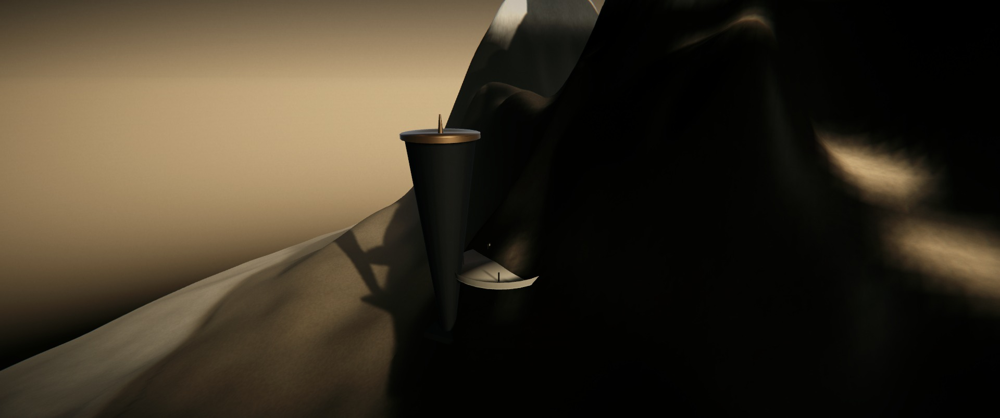
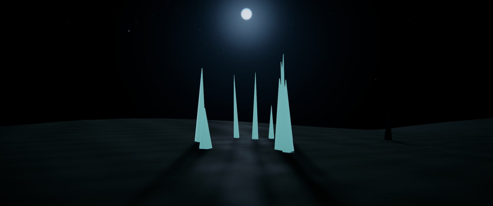

# 06 · 关键帧概念参考

> 这五张是**概念参考帧**（2.39:1），用来确认"最终应该长什么样"，**不是引擎渲染**。
> 它们由 [03-art-direction.md](03-art-direction.md) 的规则生成：
> 双日双影、单色场景、剪影与负空间、大气透视、冷火只出现在夜间。
> 生成脚本：[scripts/worldview-concept.py](../../scripts/worldview-concept.py)。

| # | 帧 | 证明的技术点 | 落到 Unity 的关键 |
| --- | --- | --- | --- |
| S1 | 第一井的清晨 | 建筑尺度、薄雾、单光源内部 | 程序化井塔 + 贴地雾 + 低对比晨光 |
| S2 | 长眠海的暮尘 | 双日双影、沙脊层次、大气透视 | 主光 + 伴光、沙纹法线、远景雾 |
| S3 | 长者过境 | 巨物尺度、沙面隆起、背脊晶簇 | 分段网格 + 顶点位移 + 冲击波 |
| S4 | 霜夜的冷火 | 双月镜面、冷火自发光、夜景分级 | 平面反射 + 自发光 + Bloom 阈值 |
| S5 | 大潮 | 沙暴墙、能见度、服务器权威事件 | 体积尘（全屏雾）+ 权威位置插值 |

---

## S1 · 第一井的清晨

倒锥井塔、钟架、两个井民。整个画面只有一个光源方向，雾把地面压平。

**要点**：塔是"倒锥 + 顶部平台"的沙漏母题；窗洞小而深，形成几个亮点；
地面几乎看不出材质，靠剪影和雾建立空间 —— 这是"低对比度清晨"的正确做法，
而不是把亮度整体拉高。

## S2 · 长眠海的暮尘

低机位，人站在近景沙丘的脊线上，赫斯压在远山后面，维尔在左上角。

**要点**：三层纵深（近景沙丘 / 中景沙脊 / 远景骨脊）；脊线被夕阳勾出一条暖边；
沙丘的背光面是冷黑而不是暖黑 —— 这一条决定了画面"贵不贵"。

## S3 · 长者过境

巨兽的三段背脊从沙下依次拱起，背脊上是不规则的青白晶簇；两个人在它脚边。

**要点**：**不要把它画成一条完整的虫**。只露出背脊，其余留在沙下，
既省掉了模型与动画，又比"全须全尾"更有压迫感。晶簇是画面里唯一的高光点。

## S4 · 霜夜的冷火

双月、盐镜、一簇青白晶簇，以及它在水面上的倒影。

**要点**：夜戏只允许两种颜色 —— 月光的蓝和冷火的青。倒影比本体更亮会更"假"，
所以倒影要压暗、模糊、加一点水平波纹。Bloom 阈值要刚好只吃冷火。

## S5 · 大潮

沙暴墙从右侧压过来，左侧还留着天空、太阳和井塔的剪影。

**要点**：**墙一定要留出"没被墙盖住的天"**，否则画面只剩一堵褐色的墙，没有尺度。
人物只有 30 px 高，靠他们和井塔来读墙的高度。

---

## 怎么用这几张图

1. **对色**：把 Unity 里的截图和 S2 并排，先对齐天空、沙、岩三块的明度关系，再谈细节。
2. **对构图**：关键截图必须满足 S2 的三层纵深与 S2/S5 的负空间比例。
3. **对光**：双影、暖边、冷阴影 —— 缺一条就说明光照还没调对。
4. **不要对细节**：这些是概念图，不追求笔触与纹理；细节以引擎渲染为准。

## 引擎实拍

三张**真实引擎渲染**（Unity 6 / URP 17.6，1920×804，2.39:1），由
`AI003.EditorTools.AshkarStill` 用现有 `world/` 数据 + 阿什卡主题 + 程序化地标生成，
批处理一次跑完（`Unity.exe -batchmode -executeMethod AI003.EditorTools.AshkarStill.Run`）。

### S2 · 长眠海的暮尘

近景沙脊压住左半、太阳压在脊线上、井塔在右侧成为尺度参照。这是目前最接近概念帧的一张。

### S1 · 第一井的清晨

井塔立在沙脊上，长影横过坡面，广场的白色圆盘在塔脚露出来。左侧是大片留白 ——
尺度读得出来，但**构图仍偏空**，塔与广场的关系还需要一次专门的机位设计。

### S4 · 霜夜的冷火

双月、星空、盐滩上的冷火晶簇及其在盐壳上的投影，右侧是人形剪影。

**已经对上的**：主题色板（同一份地形数据，不改共享文件）、双日与第二盏方向光、
沙纹法线、曲率 AO、ACES + Bloom + 分离色调 + 颗粒 + 暗角、2.39:1 直出、
程序化井塔/钟架/帆撬/人形/晶簇。

**还没对上的**：

| 差距 | 原因 | 处理 |
| --- | --- | --- |
| 沙丘形体仍偏"融化" | 地形 4 m/顶点 | 近景细分或提高世界分辨率（Phase 3） |
| 地平线是一条硬色带 | 2 km 岛外是盐海平面，雾与天空同色 | 分层高度雾 + 盐海掠射反光 |
| 天空缺尘层结构 | 只有两色渐变 + 尘带 | 加高度雾层、尘噪声、日晕 |
| S1 构图 | 塔与沙脊的遮挡没调好 | 单独做一次机位与地标摆放 |
| 冷火偏白 | 自发光强度过高 | 降 emission、加色相偏移 |

## 已知的不足

- 这几张是**程序化"画"出来的**，纹理与材质细节远达不到引擎渲染的水平；
  它们的价值在**构图、色调、光的逻辑**，不在像素。
- 巨兽（S3）只做了背脊剪影，没有做颚部与鳞板，真实模型需要另外的设定图。
- 人物只有剪影，服装的三层结构没有体现。

下一步是在 Unity 里先复现 **S2**（只需要地形 + 天空 + 双光 + 雾 + 后期），
那是 Phase 2 的 M1 验收物。
