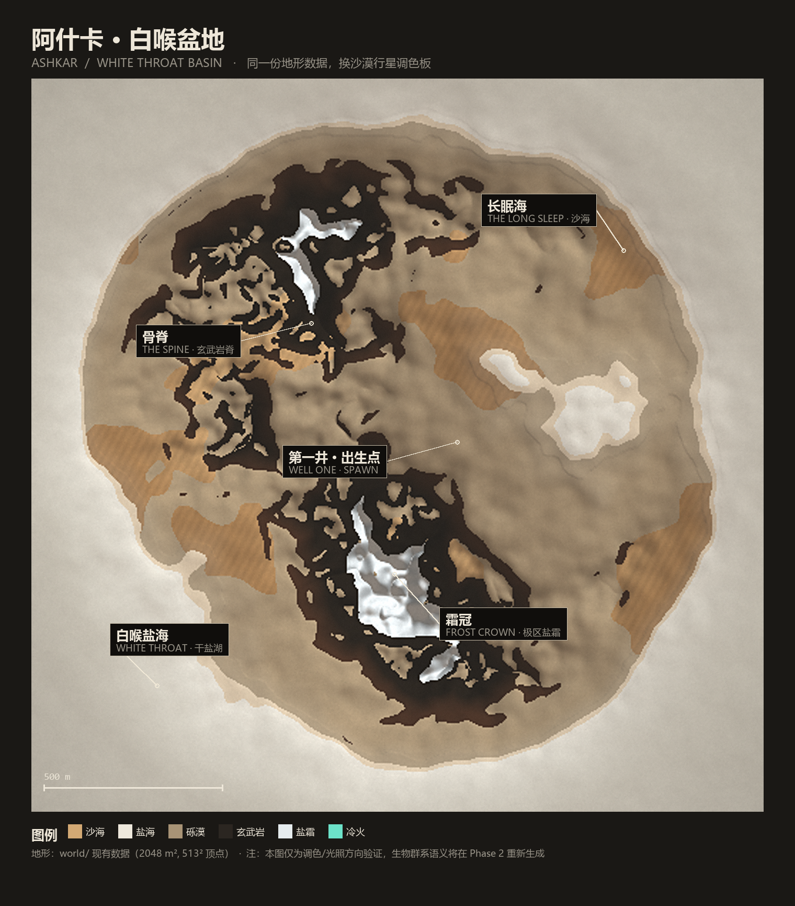
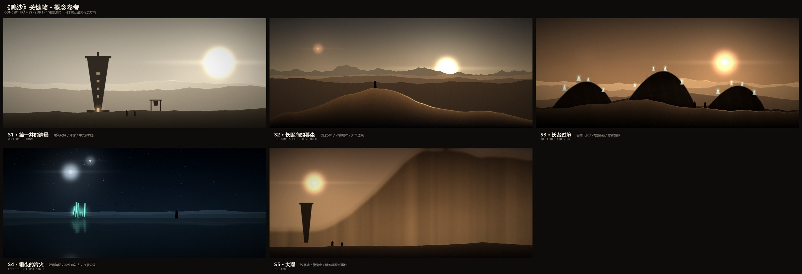

# 《鸣沙》世界观设计

> 演示代号 **AI003 · MINGSHA** ｜ 星球 **阿什卡 / Ashkar** ｜ 区域 **白喉盆地 / White Throat Basin**

这是一份**为技术演示服务**的世界观设定，不是一款游戏的设计文档。
它存在的唯一理由：让渲染、物理、网络同步这三件事有统一的视觉外壳、统一的坐标语义和统一的名词，
从而在 Unity 与 UE5 两端做出**可对照、可复现、可截图证明**的同一场演示。

最终效果的概念参考见 [06-concept-frames.md](06-concept-frames.md)：

## 三句话世界观

1. **阿什卡**是一颗被双日烤干的旱海行星：没有海，只有一片会"呼吸"的沙海 **长眠海**，和围住它的玄武岩脊 **骨脊**。
2. 沙下埋着前代海洋蒸发后留下的 **渊盐**，夜里发出冷光，俗称 **冷火**；它是唯一值得争夺的东西。
3. 沙海的主人是一头会"唱歌"的巨兽 **鸣沙兽（长者）**，它随振动而来；而每隔一段时间，**大潮**——一堵沙暴墙——会横扫整片盆地。

没有预言，没有救世主，没有贵族复仇，没有香料成瘾。
**这四条否定的东西，是这份设定最重要的部分**（见 [05-legal.md](05-legal.md)）。

## 硬约束

| 约束 | 含义 |
| --- | --- |
| **不做玩法** | 没有技能树、任务链、经济系统、等级、剧情分支。世界只提供"场景 + 规则 + 事件"。 |
| **每个设定必须兑换一个技术点** | 写进设定的东西，必须能在 [04-tech-mapping.md](04-tech-mapping.md) 里找到它证明的渲染/物理/网络能力，否则删掉。 |
| **两端同源** | 名词、坐标、色值、事件时刻都由服务器与世界数据决定；客户端不各写一份。 |

## 一页纸

| 项 | 内容 |
| --- | --- |
| 星球 | **阿什卡（Ashkar）**，星图编号 **ASH-7**，旱海型；1.2 g；自转 40 小时；稀薄富尘大气 |
| 双日 | **赫斯（Hes）** 白炽主星 + **维尔（Vyr）** 暗红伴星 → **双影**是所有镜头的签名 |
| 区域 | **白喉盆地**：2048 m × 2048 m 的采样区；外缘是白喉盐海，内部被骨脊分成东西两片沙海 |
| 沙海 | **长眠海（The Long Sleep）**，盆地中央的沙丘场，可行走、可被风重塑 |
| 岩脊 | **骨脊（The Spine）**，柱状节理玄武岩，峡谷与天然拱 |
| 盐海 | **白喉盐海（White Throat）**，干盐湖；盆地内部有少量 **卤湖**，密度大、镜面强 |
| 极冠 | **霜冠（Frost Crown）**，高处的盐霜与冰，纯白，用来做画面里的"过曝点" |
| 资源 | **渊盐（Vena Salt）**，俗称 **冷火（Coldfire）**；夜间自发光，采集会传导振动 |
| 威胁 | **鸣沙兽（长者 / The Elder）**，180–400 m 的三瓣颚巨兽，随低频振动过境 |
| 事件 | **大潮（The Tide）**，周期沙暴墙，服务器权威推进，全服可见 |
| 势力 | **曜庭**（特许开采方）、**盐路盟**（运输与拾荒行会）、**井民**（中立守井者） |
| 地标 | **第一井（Well One）**，出生点，井民的竖井聚落；以及散落的 **骨拱** 遗迹 |
| 载具 | **帆撬（Sail-sled）**，风帆沙橇，物理演示主角 |

## 命名总表

实现时**代码、资产、协议字段一律用英文 ID**，中文只出现在 UI 与文档里。

| 中文 | English | 代码 / ID | 备注 |
| --- | --- | --- | --- |
| 鸣沙 | Mingsha | `Mingsha` | 演示代号 |
| 阿什卡 | Ashkar | `Ashkar` | 星球 |
| 白喉盆地 | White Throat Basin | `WhiteThroat` | 区域 |
| 长眠海 | The Long Sleep | `LongSleep` | 沙海 |
| 骨脊 | The Spine | `Spine` | 岩脊 |
| 白喉盐海 | White Throat Sea | `SaltSea` | 干盐湖 |
| 霜冠 | Frost Crown | `FrostCrown` | 极冠 |
| 渊盐 / 冷火 | Vena Salt / Coldfire | `VenaSalt` / `Coldfire` | 资源 |
| 鸣沙兽 / 长者 | The Singing Beast / The Elder | `Elder` | 巨兽 |
| 大潮 | The Tide | `Tide` | 沙暴事件 |
| 曜庭 | The Solar Court | `SolarCourt` | 阵营 A |
| 盐路盟 | The Salt Road Compact | `SaltRoad` | 阵营 B |
| 井民 | The Wellfolk | `Wellfolk` | 中立 |
| 第一井 | Well One | `WellOne` | 地标 |
| 帆撬 | Sail-sled | `SailSled` | 载具 |
| 井塔 | Wellspire | `Wellspire` | 建筑 |

## 文档地图

| 文档 | 内容 | 谁看 |
| --- | --- | --- |
| [01-world.md](01-world.md) | 天文、地理、生物群系映射、资源、巨兽、沙暴、昼夜 | 关卡 / 世界生成 / 技术美术 |
| [02-factions.md](02-factions.md) | 三股势力、社会规则、建筑与载具语言、服装、命名法 | 美术 / 关卡 / 叙事 |
| [03-art-direction.md](03-art-direction.md) | 参考边界、色板、光照、材质、镜头、后期、UI、声音 | 技术美术 / 渲染 |
| [04-tech-mapping.md](04-tech-mapping.md) | 每个设定兑换哪个技术点 + Unity 落地路线 + 验收标准 | 客户端 / 服务器 |
| [05-legal.md](05-legal.md) | 禁用词、差异化对照、宣发口径、上线前检查 | 所有人 |
| [06-concept-frames.md](06-concept-frames.md) | 五张关键帧概念参考（构图 / 色调 / 光的逻辑） | 所有人 |

## 与现有工程的关系

- 现有世界（`world/`）是**共享数据**，Unity 与 UE5 都读它。Phase 1 只产出设计，**不改数据、不改代码**。
- 现有 6 个生物群系（海洋/沙滩/草地/沙漠/岩石/雪）在本设定里被**重新语义化**为
  盐海/盐壳/砾漠/沙海/玄武岩/盐霜，`biome id` 不变 —— 这是刻意的，让 Phase 2 的改动量最小。
- 上方那张俯视图就是**用现有 `world/` 数据 + 新色板重打光**渲染出来的
  （`scripts/worldview-preview.py`），证明"换一层美术语言"不需要先换地形。

## 当前状态

| 阶段 | 范围 | 状态 |
| --- | --- | --- |
| **Phase 1** | 世界观 + 美术方向 + 技术映射 + 法律清单（本文档集） | ✅ 完成，待确认 |
| **Phase 2** | Unity 侧落地：主题化色板、光照/雾/后期、地标、事件 | ⬜ 待开始 |
| **Phase 3** | UE5 对齐：同一主题、同一事件、同一对照截图 | ⬜ 待开始 |

Phase 2 的具体步骤与验收见 [04-tech-mapping.md](04-tech-mapping.md)。
